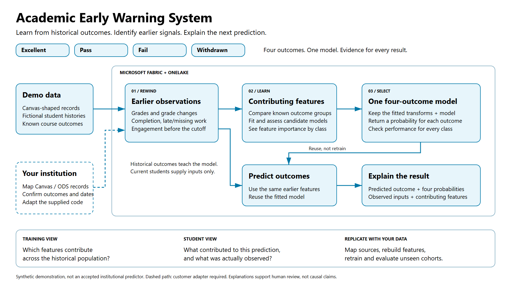

Academic Early Warning System
=============================

An end-to-end **Microsoft Fabric** accelerator that predicts each student's
course outcome (**Excellent, Pass, Fail or Withdrawn**) from learning-management
system activity, and explains every prediction, so advisors can step in early.

It ships with a fixed-seed simulator of Canvas-style LMS data, so the whole
pipeline runs without any real student records.

What it does
------------

* **Ingests** 27 LMS source tables (courses, enrollments, submissions, scores,
  web logs and their revision history) into a schema-enabled Fabric Lakehouse.
* **Builds time-aware weekly features** (due work, completion, late and excused
  work, grade level and trend, activity change) using only data available at
  each checkpoint, so there is no look-ahead leakage.
* **Trains and calibrates** a four-class logistic model, compares it with a
  prevalence baseline, and publishes exactly one model with MLflow.
* **Explains** each prediction with per-feature contributions in notebook 02.
* **Guards the data**: validation mode before publishing, refusal to overwrite
  conflicting tables, and immutable snapshots of what was published.

See the `model card <docs/model-card.rst>`_ for intended use and limitations,
and `adapting real data <docs/adapting-real-data.rst>`_ to point it at your own LMS.

Repository layout
-----------------

* ``aews/``: the Python package (simulation, features, modeling, explanations, Fabric I/O)
* ``notebooks/``: 00 load tables, 01 build and publish, 02 explore and explain
* ``sample-data/``: the simulated dataset (ZIP)
* ``config/``: source contract, simulation and modeling settings
* ``tests/``: unit tests for data import, features, model and explanations
* ``tools/``: build the data bundle and notebooks, run locally, validate data

Quickstart
----------

The steps below take you from download to predictions.

Upload the included fictional data, create Lakehouse tables, then optionally
train a model for **Excellent, Pass, Fail and Withdrawn**.

**The short version: upload one folder -> run notebook 00 -> tables are ready.**

1. Download and extract
-----------------------

* Download the repository ZIP from GitHub and choose **Extract All**.
* Open ``sample-data`` and also extract
  ``academic-early-warning-simulated-data.zip``.
* Keep the extracted files and folder names unchanged.

2. Set up Fabric
----------------

* Create workspace **Academic Early Warning System** on an available Fabric capacity.
* Create Lakehouse **academic_early_warning** with **schemas enabled**.
* In workspace Spark settings, select **Runtime 1.3 (Spark 3.5, Delta 3.2)**.
* Already have these? Reuse them. No local Python installation is needed.

3. Upload the data folder
-------------------------

* Open the Lakehouse -> **Files** -> **Upload folder**.
* Select the whole extracted ``academic-early-warning-simulated-data`` folder.
* Already uploaded it? Skip uploading again.
* **Do not use Load to Tables for the replication Quickstart.**
* Confirm this layout, without an extra copy of the data folder inside it::

      Files/
          academic-early-warning-simulated-data/
              source_parquet/
              features/
              manifest.json
              summary.json

4. Create all tables with notebook 00
-------------------------------------

* Import ``notebooks/00_load_lakehouse_tables.ipynb`` into the workspace.
* **Block 1 sets the default Lakehouse in code** to ``academic_early_warning``.
* Stop any existing notebook session, then run from the top so this setting takes effect.
* In **block 3**, set the path to your uploaded folder::

      SOURCE_FOLDER = 'Files/academic-early-warning-simulated-data'

* If the folder ends in ``-fixed``, use
  ``Files/academic-early-warning-simulated-data-fixed`` instead.
* Click **Run all**. Wait for **tables_loaded**.
* Done: **27 input tables** appear under **Tables** with the correct names.

**Only need the tables? Stop here.** Notebook 00 does not train a model or
overwrite existing tables. Matching tables are skipped; conflicting tables
cause an error.
MLflow installation is not needed for notebook 00.

5. Train the model with notebook 01 (optional)
----------------------------------------------

* Import ``notebooks/01_build_and_publish.ipynb`` and attach the same default Lakehouse.
* In **block 3**, use the same ``SOURCE_FOLDER`` as notebook 00 and keep::

      INPUT_MODE = 'folder'
      RUN_MODE = 'validate'
      ALLOW_DEMO_TABLE_REPLACEMENT = False

* Click **Run all**. Wait for **validation: passed**.
* In this synthetic demo Lakehouse only, change these two lines in block 3::

      RUN_MODE = 'publish'
      ALLOW_DEMO_TABLE_REPLACEMENT = True

* Click **Run all** again. Wait for **publication_completed**.

**Notebook 01 archives and replaces the named demo tables**, including those
loaded by notebook 00. It trains the model and creates predictions. Use one
writer at a time, never production tables. No second data upload is needed.

6. Explore predictions with notebook 02 (optional)
--------------------------------------------------

* After **publication_completed**, import ``notebooks/02_explore_and_explain.ipynb``.
* Attach the same default Lakehouse and click **Run all**.
* View predictions and feature contributions. Block 6 prefills an enrollment ID and outcome.
* When finished, stop notebook sessions and pause idle capacity according to your policy.

Stuck?
------

* **Folder not found:** check ``SOURCE_FOLDER`` and the folder layout in step 3.
* **Wrong workspace/Lakehouse:** use the exact names above, or follow
  `custom names <docs/replication-guide.rst#custom-names>`_.
* **Existing table mismatch:** review the conflict; do not delete data to bypass the guard.
* **No current publication:** finish notebook 01 in publish mode before running notebook 02.
* **Other errors:** see `troubleshooting <docs/replication-guide.rst#troubleshooting>`_.

References
----------

* `Detailed setup, recovery and local development <docs/replication-guide.rst>`_.
* `ZIP upload alternative <docs/replication-guide.rst#zip-upload-alternative>`_:
  **Upload files** to **Files/uploads**, then use notebook 01 in ``uploaded`` mode.
* `Architecture diagram <assets/academic-early-warning-system.png>`_ |
  `SVG <assets/academic-early-warning-system.svg>`_ |
  `Editable diagram <assets/academic-early-warning-system.excalidraw>`_.
* `Model limitations <docs/model-card.rst>`_ |
  `Adapting real data <docs/adapting-real-data.rst>`_ |
  `License <LICENSE>`_.

**Synthetic demonstration only, not a production system or institutional
accuracy claim.** The new folder workflow has not been run end to end in Fabric.
Capacity and storage charges remain your responsibility.

Parquet file-to-table names
---------------------------

**Reference only: notebook 00 handles this automatically.**
The 115 Parquet files map to **27 input tables**.

* Do not rename files. Paths below start inside the extracted data folder.
* ``part-*.parquet`` means all five parts, ``part-01`` through ``part-05``,
  in that one table folder. They form one table, not five.
* JSON files are metadata, not tables. ``gold`` results are created by notebook 01.

.. list-table:: Parquet files and destination Delta tables
   :header-rows: 1
   :widths: 60 15 25

   * - Parquet file(s) to load together
     - Schema
     - New table name
   * - ``features\current.parquet``
     - ``silver``
     - ``current_weekly_features``
   * - ``features\historical.parquet``
     - ``silver``
     - ``historical_weekly_features``
   * - ``source_parquet\canvas\accounts\part-00.parquet``
     - ``canvas``
     - ``accounts``
   * - ``source_parquet\canvas\assignment_groups\part-*.parquet``
     - ``canvas``
     - ``assignment_groups``
   * - ``source_parquet\canvas\assignment_override_students\part-*.parquet``
     - ``canvas``
     - ``assignment_override_students``
   * - ``source_parquet\canvas\assignment_overrides\part-*.parquet``
     - ``canvas``
     - ``assignment_overrides``
   * - ``source_parquet\canvas\assignments\part-*.parquet``
     - ``canvas``
     - ``assignments``
   * - ``source_parquet\canvas\course_sections\part-*.parquet``
     - ``canvas``
     - ``course_sections``
   * - ``source_parquet\canvas\courses\part-*.parquet``
     - ``canvas``
     - ``courses``
   * - ``source_parquet\canvas\enrollment_terms\part-00.parquet``
     - ``canvas``
     - ``enrollment_terms``
   * - ``source_parquet\canvas\enrollments\part-*.parquet``
     - ``canvas``
     - ``enrollments``
   * - ``source_parquet\canvas\scores\part-*.parquet``
     - ``canvas``
     - ``scores``
   * - ``source_parquet\canvas\submissions\part-*.parquet``
     - ``canvas``
     - ``submissions``
   * - ``source_parquet\canvas\users\part-00.parquet``
     - ``canvas``
     - ``users``
   * - ``source_parquet\canvas_logs\web_logs\part-*.parquet``
     - ``canvas_logs``
     - ``web_logs``
   * - ``source_parquet\sim_history\assignment_groups_revisions\part-*.parquet``
     - ``sim_history``
     - ``assignment_groups_revisions``
   * - ``source_parquet\sim_history\assignment_override_students_revisions\part-*.parquet``
     - ``sim_history``
     - ``assignment_override_students_revisions``
   * - ``source_parquet\sim_history\assignment_overrides_revisions\part-*.parquet``
     - ``sim_history``
     - ``assignment_overrides_revisions``
   * - ``source_parquet\sim_history\assignments_revisions\part-*.parquet``
     - ``sim_history``
     - ``assignments_revisions``
   * - ``source_parquet\sim_history\course_sections_revisions\part-*.parquet``
     - ``sim_history``
     - ``course_sections_revisions``
   * - ``source_parquet\sim_history\courses_revisions\part-*.parquet``
     - ``sim_history``
     - ``courses_revisions``
   * - ``source_parquet\sim_history\enrollments_revisions\part-*.parquet``
     - ``sim_history``
     - ``enrollments_revisions``
   * - ``source_parquet\sim_history\scores_revisions\part-*.parquet``
     - ``sim_history``
     - ``scores_revisions``
   * - ``source_parquet\sim_history\submissions_revisions\part-*.parquet``
     - ``sim_history``
     - ``submissions_revisions``
   * - ``source_parquet\sim_history\web_logs_revisions\part-*.parquet``
     - ``sim_history``
     - ``web_logs_revisions``
   * - ``source_parquet\sim_support\course_withdrawal_events\part-*.parquet``
     - ``sim_support``
     - ``course_withdrawal_events``
   * - ``source_parquet\sim_support\gradebook_qualification\part-*.parquet``
     - ``sim_support``
     - ``gradebook_qualification``

Development
-----------

Tests run with the pinned versions in ``requirements.txt`` (Python 3.10 or 3.11)::

    pip install -r requirements.txt pytest
    python -m pytest

Newer scikit-learn (1.6+) and MLflow releases change APIs this project uses
(for example ``CalibratedClassifierCV(cv="prefit")``), so stay on the pins.

Disclaimer and licence
----------------------

This is an experimental synthetic-data demonstration, not a supported production
system or an official Microsoft offering. Product names identify interoperability
targets, not endorsement. Released under the `MIT License <LICENSE>`_.
