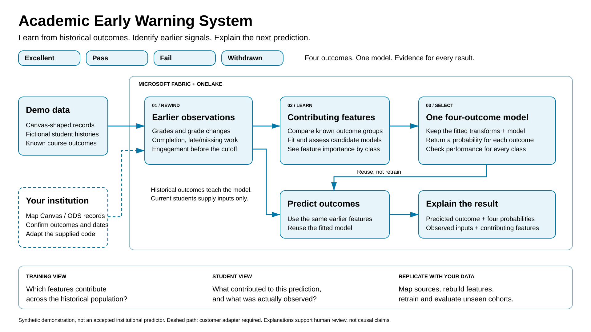

Academic Early Warning System
=============================

A self-contained, synthetic-data starter for explaining an early-warning
method at student-course enrollment grain. It is not a production system,
an approved Microsoft offering, or an institutional accuracy claim.

Presentation assets: `vector diagram <assets/academic-early-warning-system.svg>`_,
`presentation image <assets/academic-early-warning-system.png>`_ and
`editable diagram <assets/academic-early-warning-system.excalidraw>`_.

Start here: upload the ZIP, then run the notebooks
--------------------------------------------------

.. important::

   **Do not use Load to Tables for the replication Quickstart.**
   Extract only the outer repository ZIP. Upload the inner
   ``academic-early-warning-simulated-data.zip`` **unchanged** under Lakehouse
   **Files/uploads**. The first notebook creates the separate tables for you.
   Do not load the extracted dataset folder or the ``features`` folder as
   one table, and do not choose CSV or Parquet in a manual table-load wizard.

The intended sequence is::

    Extract repository ZIP on your computer
        -> Upload the inner simulated-data ZIP to Lakehouse Files/uploads
        -> Import and attach the two notebooks
        -> First notebook: validate, then publish
        -> Second notebook: explore the model and explanations

If you already extracted or manually loaded some data, **do not delete it to
start over**. Upload the original inner ZIP to the location above and follow
the Quickstart. Review replacement scope before authorizing publication.
An extracted folder does not substitute for the ZIP the notebook expects.

Quickstart: replicate with the included dataset
-----------------------------------------------

**Everything needed for the synthetic input is included.** You do not need to
generate data or install Python locally to use the prebuilt notebooks with the
default resource names. You do need access to Microsoft Fabric, a capacity
with available quota, and permission to create a workspace and Lakehouse.
Capacity and storage charges are your responsibility.

1. Download or clone the complete repository. If you downloaded a ZIP, use
   **Extract All** on your computer and open the extracted repository folder.
   You should see ``README.rst``, ``notebooks`` and ``sample-data``.
   There are two different ZIPs: the **repository ZIP** you just extracted and
   the **simulated-data ZIP** inside ``sample-data``.
   For this automated notebook quickstart, keep the inner file
   ``sample-data/academic-early-warning-simulated-data.zip`` **compressed**.
   Continue with the notebook workflow below; do not extract the inner ZIP
   for this workflow.

2. In your approved Fabric environment, create or select a capacity and create
   a workspace named **Academic Early Warning System**, assigned to that
   capacity. Create a Lakehouse named **academic_early_warning**, with
   **Lakehouse schemas enabled**. Set its workspace Spark runtime to
   **1.3 (Spark 3.5, Delta 3.2)**.

3. Open that Lakehouse. Under **Files**, create a folder named ``uploads``.
   Open the folder, choose **Upload files** (not **Load to Tables**), and
   select the single ``academic-early-warning-simulated-data.zip`` file from
   your computer's extracted repository ``sample-data`` directory.
   Before moving on, confirm the uploaded item is a ZIP **file**, not an
   extracted folder. The expected Lakehouse layout is::

       Files/
           uploads/
               academic-early-warning-simulated-data.zip

   Its exact notebook path is
   ``Files/uploads/academic-early-warning-simulated-data.zip``.

   There is no Parquet/CSV selection or destination table name at this step.
   Tables do not need to exist yet. The build notebook verifies the archive,
   extracts its records and publishes each table separately.

4. Import both notebooks from the repository's ``notebooks`` folder into the
   workspace. Attach **academic_early_warning** as the **default Lakehouse**
   for each notebook. No tenant IDs or credentials need to be entered.

5. Open ``01_build_and_publish.ipynb`` and leave these settings unchanged::

       INPUT_MODE = 'uploaded'
       RUN_MODE = 'validate'
       ALLOW_DEMO_TABLE_REPLACEMENT = False

   Run all cells. Expect ``dataset: verified`` and ``validation: passed``.
   This checks the runtime, exact target names, ZIP checksum, every included
   file, source schema/counts/keys, and prepared feature boundaries. It does
   not create or replace tables or train a model.

6. Review the replacement scope below. In this synthetic development
   Lakehouse only, change ``RUN_MODE`` to ``'publish'`` and
   ``ALLOW_DEMO_TABLE_REPLACEMENT`` to ``True``. Keep
   ``INPUT_MODE = 'uploaded'``. Run all cells again. It loads the included
   source records, uses the included precomputed point-in-time features,
   trains and calibrates one four-class model, and publishes its results.
   It does **not** run the synthetic generator in uploaded mode.

   Success is the notebook message ``publication_completed``. You should then
   see separate ``canvas``, ``canvas_logs``, ``sim_history``, ``sim_support``,
   ``silver`` and ``gold`` schemas under **Tables**. A successful manual
   Parquet load alone does not mean this replication step is complete.

7. Wait for ``publication_completed``. Open ``02_explore_and_explain.ipynb``
   and run all cells. Expect the ``small`` profile, 583 current predictions,
   explanations for those predictions, and training feature contributions
   for each of the four outcomes. Block 6 automatically fills and prints
   ``ENROLLMENT_TO_EXPLAIN`` and ``OUTCOME_TO_EXPLAIN`` using the first
   current enrollment and its actual predicted outcome; no values are required
   to run the example. To inspect a different enrollment, edit its assignment
   in block 6 and rerun blocks 6 and 7.

8. Stop notebook sessions and pause idle capacity according to your
   organization's policy. This repository does not perform those operations
   automatically. Keep the archive and current-publication manifest.

**Using other resource names?** Edit ``intended_workspace``,
``intended_lakehouse`` and ``experiment_name`` in
``config/simulation.json``, then rebuild both notebooks with
``python tools\build_notebooks.py`` before importing. Alternatively, edit
those three ``SOURCE_CONFIG`` entries consistently in **both notebooks**
after their configuration cell initializes them. Do not bypass the guards.

Included data
-------------

``sample-data/academic-early-warning-simulated-data.zip`` is approximately
15.6 MB compressed (24.6 MB expanded). It contains 117 files: selected
source-shaped records, immutable revisions, supplemental outcome events,
historical/current feature Parquet files, checksums and generation summary.
No pretrained model, prediction results or real student records are included.

=============================== =========
Included synthetic data         Rows
=============================== =========
Learners / instructors          400 / 8
Course offerings / terms        40 / 5
Student enrollments             3,000
Submissions                     60,000
Activity records                111,217
Historical feature snapshots    2,336
Current feature snapshots       583
=============================== =========

The feature tables were computed from the bundled histories during dataset
preparation, not during upload. Training and predictions are computed in your
environment. Current-term feature files contain no future labels. See
``sample-data/README.txt`` and ``sample-data/bundle-info.json`` for provenance,
exact hashes and counts. These files must stay paired with the notebooks.

Extract files for manual table loading
--------------------------------------

**Advanced inspection only, not an alternative way to run the replication
Quickstart.** Skip this section if your goal is to build the model using the
included notebooks. It describes inspecting selected data as tables, not the
model training/publication workflow.

1. Extract the repository ZIP on your computer first. Then open ``sample-data``
   and use **Extract All** on ``academic-early-warning-simulated-data.zip``.
   Keep the original inner ZIP too; the build notebook still expects that file.

2. Open the extracted dataset folder. Its table layout is::

       source_parquet/
           canvas/users/part-00.parquet
           canvas/submissions/part-01.parquet ... part-05.parquet
           canvas_logs/web_logs/part-01.parquet ... part-05.parquet
           sim_history/<table>_revisions/part-01.parquet ...
           sim_support/course_withdrawal_events/part-01.parquet ...
       features/
           historical.parquet
           current.parquet
       manifest.json
       summary.json

3. Upload the selected extracted files or table folder under Lakehouse
   **Files**, preserving a separate folder for each table. Select that
   table's Parquet file or folder and choose **Load to tables**, select
   **Parquet**, and give the destination table a meaningful name.
   If several ``part-*.parquet`` files belong to one table, load all of those
   parts together, not just the first term.

4. **Do not select the dataset root, ``source_parquet/canvas`` or the entire
   ``features`` folder as one table.** Those locations contain different
   schemas. Do not include ``manifest.json`` or ``summary.json`` as Parquet.
   Load ``features/historical.parquet`` and ``features/current.parquet``
   separately; only historical features contain outcome labels.

5. Manual loading creates data tables only. It does not train a model or
   create the publication manifest required by the exploration notebook.
   To replicate the complete model workflow, upload the original unmodified
   simulated-data ZIP to ``Files/uploads`` and follow the Quickstart.
   Its publish step archives and replaces the named demo tables, so use only
   a synthetic development Lakehouse, not production data.

All timestamp columns in the corrected bundle are stored as Parquet
**microseconds**, which avoids the unsupported ``TIMESTAMP(NANOS,true)``
encoding. Keep current data and current notebooks together so their checksums
match; do not recompress the data ZIP for the automated path.

What it demonstrates
--------------------

1. Load the included correlated Canvas-shaped synthetic history, or generate
   a larger population with the fixed seed.
2. Reconstruct what was observable at week four, using both effective time
   and recorded/available time. Join later outcomes only to historical rows.
3. Fit training-only transformations, calibrate and select one logistic
   classifier that returns four probabilities:

   * Excellent: qualified final course grade at least 90.
   * Pass: qualified final grade from 60 to below 90.
   * Fail: qualified final grade below 60.
   * Withdrawn: an explicit course-withdrawal event after the checkpoint.
     This takes precedence over a passing/failing grade.

   Unknown or unqualified outcomes are not silently treated as Fail.
   These thresholds and time rules are illustrative, not institutional policy.

4. Score current enrollments without future labels. Explain each predicted
   class and global per-outcome feature contributions.

No separate withdrawal workflow, student outreach, automatic acceptance or
accepted-model registration is implemented. Real Canvas ingestion is also
**not implemented**: changing configuration or credentials does not connect
real data. An explicit CD2/ODS adapter and institution-approved history/label
mapping are required. See `adapting real data <docs/adapting-real-data.rst>`_.

Two notebooks, one code base
---------------------------

``notebooks/01_build_and_publish.ipynb``
    Self-contained uploaded-data loading or optional source generation,
    modeling and guarded publication. Default mode validates the attached
    environment and included data without table changes.

``notebooks/02_explore_and_explain.ipynb``
    Read-only inspection of the complete publication, development evaluation,
    global training contributions and selectable enrollment explanations.
    It verifies that the saved model reproduces the published probabilities.

The workflow is: same source code -> build notebooks -> import into Fabric ->
attach the intended Lakehouse -> validate the included ZIP -> authorize
publication -> explore. The dataset is supplied; no downloaded model or
external fixture is needed. Rebuild and reimport
both notebooks after source or configuration changes.

This is a portable implementation of the method, not a distribution of the
original demonstration's trained weights. Fresh runs create their own model
and publication identifiers. The current four-outcome selection protocol is
documented below; do not assume byte-identical scores to another deployment.

Local quickstart (PowerShell, Python 3.11)
----------------------------------------

Run these commands from this repository's root::

    py -3.11 -m venv .venv
    .\.venv\Scripts\python.exe -m pip install -r requirements.txt
    .\.venv\Scripts\python.exe tools\build_notebooks.py
    .\.venv\Scripts\python.exe -m unittest discover -s tests -v
    .\.venv\Scripts\python.exe tools\validate_included_data.py
    .\.venv\Scripts\python.exe tools\scan_package.py

This optional local route loads the included archive, validates it, and trains
and scores locally without generating data. It validates source keys, types,
enums, nullability, references, feature boundaries, training splits, probabilities
and exact explanation arithmetic. Temporary extraction is removed on
completion. It does not invoke Spark, authenticate,
call a cloud API, train in Fabric or log to a remote MLflow experiment.

To generate new data locally instead, run
``python tools\run_local.py --profile small``. Each generator run creates a
fresh ignored ``outputs/small/<timestamp>/`` directory.
Read ``validation-summary.json`` for actual counts. The supplied small
profile has 400 learners, 8 instructors, 40 courses, 3,000 student enrollments
(3,040 including teachers), and 60,000 submissions. Current predictions can
be fewer than enrollments because already-withdrawn learners are not scored.
The full profile has 5,000 learners, 80 instructors, 400 courses, 60,000
student enrollments and 1.2 million submissions. Generated data, model binaries
and validation output are not distributed in this repository, except for
the explicitly included synthetic input ZIP.

Use ``--features-only`` to skip raw Parquet staging, or ``--profile full`` for
a larger local run. Neither option changes the simulator's label rules.
Local runs do not persist a serialized fitted model; rebuild from source.

Fabric manual setup
-------------------

Use a separate, institution-approved development environment. Manually create
or select capacity and a workspace, assign the workspace to capacity, then
create a **schema-enabled** Lakehouse. Use Runtime 1.3:
Python 3.11, Spark 3.5 and Delta 3.2. The compatibility requirements are
NumPy 1.26.4, pandas 2.1.4, scikit-learn 1.2.2, PyArrow 14.0.2 and
MLflow 2.12.2. The cloud preflight checks these versions. Do not install this
local requirements file into an active Spark session.

Import the two built notebooks. Attach the configured Lakehouse as the default
for each, in the configured workspace. Run the build notebook first with
``RUN_MODE = 'validate'`` and ``ALLOW_DEMO_TABLE_REPLACEMENT = False``.
Keep ``INPUT_MODE = 'uploaded'`` for the included dataset. Only after it passes
and you have reviewed replacement scope, change
``RUN_MODE`` to ``'publish'`` and the acknowledgment to ``True``, then run
top to bottom. Uploaded publication uses the supplied small profile.
For a larger dataset, set ``INPUT_MODE = 'generate'`` before running the
configuration cell; the generator branch uses the full profile and computes
its features from scratch. Do not run both workflows concurrently.

The package's local validation does not verify your tenant's permissions,
capacity, catalog behavior or MLflow integration. These remain manual runtime
checks. Exact numbered steps are in `replication guide <docs/replication-guide.rst>`_.

Configuration and storage
-------------------------

``config/simulation.json`` controls profiles, seed and the exact target
workspace, Lakehouse and MLflow experiment names. Defaults are workspace
``Academic Early Warning System``, Lakehouse ``academic_early_warning``,
experiment ``Academic Early Warning System Training``, seed 271828.
``config/modeling.json`` controls the fixed calibration and selection protocol.
``config/canvas-source-contract.json`` describes the selected public projection.
No tenant, workspace, Lakehouse or item identifiers are embedded.

Builders consume these files without an environment-specific fallback::

    .\.venv\Scripts\python.exe tools\build_notebooks.py --config-dir config

Stable Lakehouse schemas are ``canvas``, ``canvas_logs``, ``sim_history``,
``sim_support``, ``silver`` and ``gold``. Files roots are ``data``,
``model_artifacts`` and ``_archive``. The current publication pointer is
``Files/model_artifacts/current.json`` and includes code, training, source,
model and run provenance.

Safety and replacement scope
----------------------------

* Never attach a replacement-enabled notebook to production tables.
* Only the contract's named source tables, their ``sim_history`` revision
  tables, two ``sim_support`` tables, two ``silver`` feature tables and four
  ``gold`` result tables are replaced. Other tables are not deleted.
* All existing named tables are archived and verified before the first
  replacement. New immutable snapshots are created before the pointer changes.
* ``current.json`` advances only after verification. The exploration notebook
  reads that publication's immutable snapshots, not a mixture of active tables.
* Publication is not a multi-table transaction. On a failure, stable tables
  may be partially replaced; the previous pointer and snapshots remain for
  recovery. Use one writer only and do not explore during publication.
* No automatic archive retention, rollback, locking, budget alerts, scheduling
  or capacity pause/resume is supplied. Stop idle sessions and use approved
  cost controls. Archived data and storage can continue to incur charges.
* MLflow model loading deserializes code. Only load this trusted workspace's
  own artifacts; never point the reader to an untrusted model.

Interpretation and release review
--------------------------------

Terms 1-2 fit imputation, scaling and candidates. Term 3 is split into
calibration and decision folds. The decision fold selects a logistic candidate
by macro one-vs-rest average precision, then log loss, with a prevalence
baseline for context. Term 4 was previously exposed in the prototype and is
**not a new independent validation cohort**. Optional term-4 diagnostics
default off. All synthetic metrics are demonstration-only.

Global importance is mean absolute training-centered contribution to each
underlying linear class score. Local values are signed class-score
contributions, including grouped missing indicators. These are not causal
effects, percentage contributions, probability-point changes or tests of
feature significance. See `model card <docs/model-card.rst>`_.

No open-source license is selected. Review ``LICENSE_NOTICE.txt`` and complete
organization-approved licensing, privacy, security and release review before
public distribution. The hygiene scanner is a convenience, not a release
approval. Exclude ``outputs``, environments, caches, credentials and generated
artifacts when sharing or creating an archive. The deliberate exception is the
single version-matched input ZIP under ``sample-data``; keep it included.

Troubleshooting
---------------

* **Illegal Parquet type: INT64 (TIMESTAMP(NANOS,true)):** an earlier bundle
  encoded timestamps in the two prepared feature files at nanosecond precision.
  Use the corrected simulated-data ZIP and matching build notebook from the
  same repository revision. Replace the previously uploaded affected files
  in your own demo folder. Selecting Parquet in the UI cannot change the
  timestamp encoding already inside a file.
* **ZIP not found:** upload the inner dataset ZIP to ``Files/uploads``, not
  the outer repository ZIP. Names are case-sensitive.
* **Checksum mismatch:** use the data ZIP shipped with these notebooks.
  Do not recompress or edit it. After a deliberate dataset rebuild using
  ``python tools\build_data_bundle.py --replace``, rebuild both notebooks.
* **Target mismatch:** attach the Lakehouse as default and configure names
  consistently in both notebooks. Restart after changing the default Lakehouse.
* **Runtime mismatch:** choose Runtime 1.3 and review the reported versions.
  Do not bypass guards or install packages mid-session without review.
* **No current publication:** finish the first notebook in publish mode.
* **Paused or throttled capacity:** resume or wait for existing work; do not
  start concurrent copies of the same notebook.
* **Poor class metrics:** preserve the negative finding. Synthetic results
  are illustrative, not institutional performance guarantees.
